<h1 align="center">Hi, I'm Argus</h1>

Mobile developer building Android &amp; iOS apps end to end — from idea to Play Store / App Store.

  
  
  
  
  

### Tech I work with

  
  
  
  
  
  
  

### GitHub stats

  <picture>
    <source media="(prefers-color-scheme: dark)" srcset="https://raw.githubusercontent.com/arguswaikhom/arguswaikhom/main/profile/stats-dark.svg">
    
  </picture>
  <picture>
    <source media="(prefers-color-scheme: dark)" srcset="https://raw.githubusercontent.com/arguswaikhom/arguswaikhom/main/profile/top-langs-dark.svg">
    
  </picture>

Cards are regenerated daily by a GitHub Action in this repo (<code>.github/workflows/readme-cards.yml</code>).
